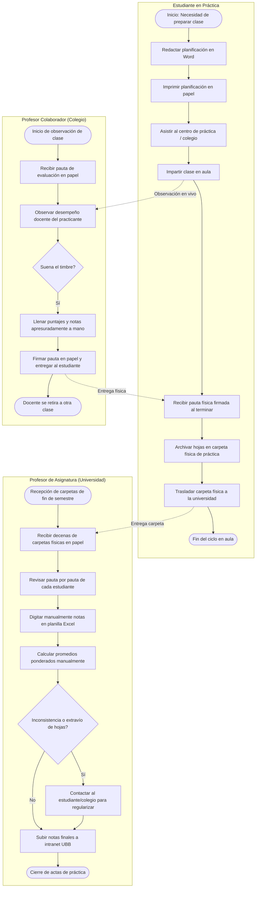
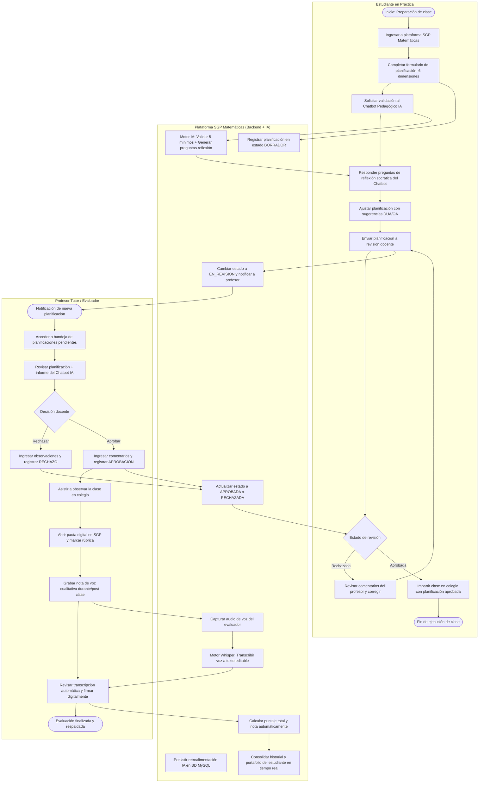

# Modelado de Procesos de Negocio (BPMN) — Sistema de Gestión de Prácticas

Este documento contiene la especificación y los diagramas formales de procesos bajo estándar **BPMN (Business Process Model and Notation)** para la entrega del **Sprint 1 de Ingeniería de Software 2026**.

---

## 1. Proceso Actual del Cliente: Diagrama As-Is (BPMN)

### Descripción de la Problemática Detectada
En el proceso actual de la carrera de Pedagogía en Educación Matemática de la UBB:
1. **Planificación aislada:** El estudiante redacta su planificación en documentos Word sin una guía interactiva ni validación previa de directrices curriculares y DUA.
2. **Evaluaciones en papel y presión de tiempo:** Durante la observación en el aula escolar, cuando toca el timbre el profesor colaborador debe trasladarse inmediatamente a otra sala, lo que provoca observaciones cualitativas incompletas o apresuradas.
3. **Logística física ineficiente:** Las evaluaciones se acumulan en carpetas de papel que el estudiante traslada físicamente a la universidad al finalizar las semanas de práctica (1 pauta en práctica intermedia, 4 en pedagógica, 8 en profesional).
4. **Carga administrativa docente:** El profesor de la asignatura universitaria debe transcribir manualmente cada pauta física a planillas Excel para calcular promedios, existiendo riesgo de extravío, inconsistencias y nula retroalimentación formativa oportuna.

### Diagrama As-Is en Notación Mermaid (BPMN Workflow)

---

## 2. Proceso Mejorado Propuesto: Diagrama To-Do (BPMN)

### Descripción de la Propuesta de Valor (SGP Matemáticas)
1. **Estandarización y reflexión pedagógica:** El estudiante planifica en la plataforma web mediante un formulario guiado por la pauta oficial (6 dimensiones). Antes de enviar, un **Chatbot IA Pedagógico** valida los 5 mínimos obligatorios y formula preguntas de mediación para potenciar la coherencia didáctica y el enfoque DUA.
2. **Supervisión y control docente previo:** El profesor tutor revisa la planificación en línea, accediendo a la retroalimentación del chatbot, y aprueba o rechaza con comentarios antes de que la clase sea ejecutada.
3. **Observación ágil con notas de voz:** El evaluador (profesor colaborador o tutor) califica la rúbrica digital desde cualquier dispositivo móvil o laptop. Para no perder tiempo escribiendo cuando toca el timbre, graba **notas de voz** que la IA (Whisper) transcribe automáticamente a texto editable.
4. **Cálculo automatizado y trazabilidad:** Las calificaciones, ponderaciones y portafolios se consolidan en tiempo real en la base de datos MySQL, eliminando el papel y la transcripción manual.

### Diagrama To-Do en Notación Mermaid (BPMN Workflow)

---

## 3. Matriz Comparativa de Procesos (As-Is vs. To-Do)

| Aspecto Evaluado | Proceso Actual (As-Is) | Proceso Propuesto con SGP (To-Do) | Beneficio Concreto |
|---|---|---|---|
| **Estructuración de Planificación** | Documento Word libre, sin validación institucional obligatoria. | Formulario web estandarizado con las 6 dimensiones de la pauta real. | 100% de coherencia con el marco curricular MINEDUC y DUA. |
| **Acompañamiento Formativo** | Nulo antes de la clase; el estudiante entrega sin filtro. | Chatbot Pedagógico con IA que verifica 5 mínimos y genera reflexión. | Retroalimentación instantánea que eleva la calidad didáctica. |
| **Supervisión Previa** | Informal o inexistente por falta de tiempo docente. | Flujo de aprobación/rechazo formal en plataforma antes de la clase. | Asegura que ninguna clase se dicte sin validación pedagógica. |
| **Captura de Observaciones** | Pautas impresas en papel; anotaciones breves por toque de timbre. | Rúbrica digital + notas de voz con transcripción automática Whisper. | Ahorro del 80% del tiempo de redacción sin perder detalle cualitativo. |
| **Gestión de Notas y Actas** | Transcripción manual de decenas de hojas de papel a Excel. | Consolidación y cálculo automatizado de notas en MySQL. | Eliminación de errores de digitación, extravíos y sobrecarga administrativa. |