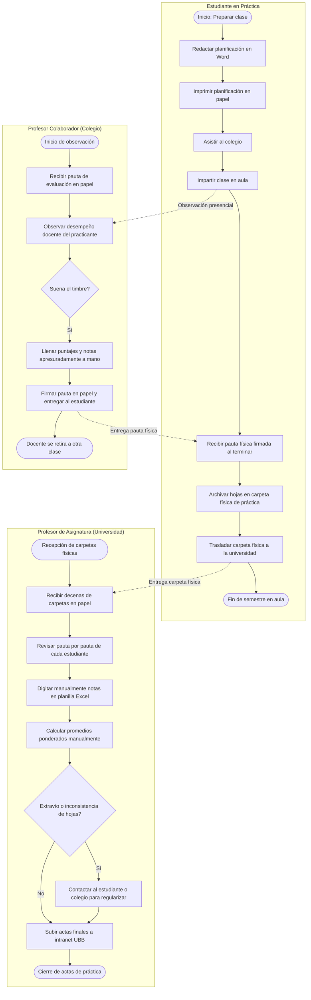
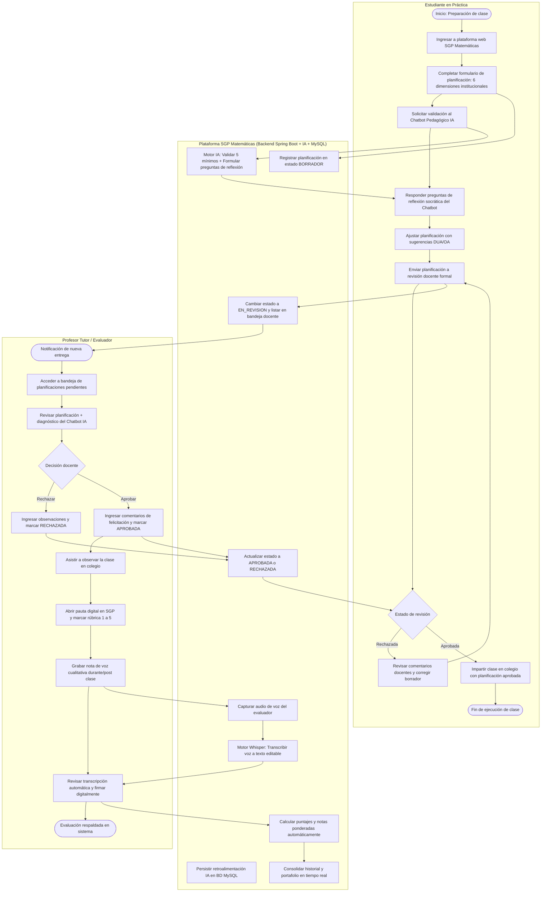
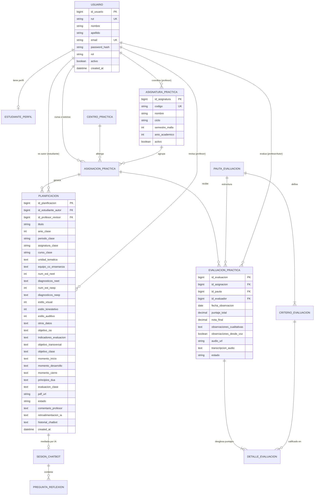

# Dossier de Entrega Sprint 1 — Ingeniería de Software 2026
## Sistema de Gestión de Prácticas Pedagógicas (SGP Matemáticas)
### Universidad del Bío-Bío — Facultad de Educación y Humanidades / DDI & ICI

---

## 1. Identificación y Contexto del Proyecto

| Campo | Detalle |
|---|---|
| **Asignatura** | Ingeniería de Software (ISW) — 2026 |
| **Institución** | Universidad del Bío-Bío (UBB) |
| **Proyecto** | Sistema de Gestión Pedagógica de Prácticas (SGP Matemáticas) |
| **Cliente / Stakeholder** | Escuela de Pedagogía en Educación Matemática UBB (Dirección de Escuela, Coordinación de Prácticas y Profesores Tutores) |
| **Hito Evaluado** | **Entrega Sprint 1** (Metodología, Historias de Usuario, Backend Spring Boot, MER MySQL y Retrospectiva) |

### Contexto del Negocio y Problemática Detectada
El proceso de formación práctica de la carrera de Pedagogía en Educación Matemática está estructurado en **seis asignaturas distribuidas en tres ciclos progresivos**:
1. **Ciclo Inicial (2° y 3° año):** *Aproximación Escolar* y *Ambiente de Aprendizaje* (simulaciones en aula universitaria, sin visitas a colegios).
2. **Ciclo Intermedio (3° y 4° año):** *Trabajo Colaborativo en el Aula* e *Investigación en el Aula* (trabajo en duplas en colegios por 3 y 4 semanas; el profesor colaborador emite 1 pauta en papel).
3. **Ciclo Avanzado / Profesional (4° y 5° año):** *Práctica Pedagógica* (6 semanas, 4 pautas) y *Práctica Profesional* (13 semanas, 8 pautas evaluadas por profesor colaborador de colegio y tutor UBB; informe final y proyecto de intervención).

#### Dolores Críticos del Proceso Actual:
- **Planificaciones sin mediación formativa previa:** El estudiante practicante elabora sus planificaciones en Word sin verificación sistemática de directrices curriculares MINEDUC ni enfoque DUA (Diseño Universal para el Aprendizaje).
- **Evaluaciones apresuradas al toque de timbre:** Cuando termina la clase escolar observada, el profesor del colegio debe retirarse velozmente a atender otro curso; no dispone de tiempo para redactar observaciones cualitativas detalladas en papel.
- **Logística física ineficiente y riesgo de extravío:** El practicante traslada carpetas físicas de papel con pautas de evaluación que entrega al final del semestre.
- **Carga administrativa excesiva:** El profesor de asignatura UBB debe transcribir manualmente decenas de pautas en papel a planillas Excel para calcular notas finales, generando retrasos y errores humanos.

---

## 2. Metodología Ágil (Scrum)

### 2.1. Diagramas de Procesos de Negocio (BPMN)

#### A. Proceso Actual del Cliente: Diagrama As-Is (BPMN)
Modela el flujo tradicional manual basado en papel y carpetas físicas:



#### B. Proceso Mejorado Propuesto: Diagrama To-Do (BPMN)
Modela la solución integrada mediante la plataforma **SGP Matemáticas**, incorporando mediación interactiva con **Chatbot IA** y captura ágil de observaciones con **notas de voz transcritas por IA**:



---

### 2.2. Product Backlog del Proyecto

El Product Backlog contiene el inventario priorizado de requisitos expresados como Historias de Usuario bajo el formato canónico Connextra (`Como [rol], quiero [acción], para [beneficio]`), evaluados bajo el criterio **INVEST** (Independiente, Negociable, Valiosa, Estimable, Pequeña, Testeable) y estimados mediante la escala Fibonacci (1, 2, 3, 5, 8 Story Points):

| ID | Historia de Usuario (Plantilla Connextra) | Tipo | Prioridad | SP | Criterio INVEST | Sprint |
|---|---|---|---|---|---|---|
| **HU-01** | Como estudiante o profesor, quiero iniciar sesión con mi correo institucional y contraseña, para acceder de manera segura a las funcionalidades correspondientes a mi rol. | F | Alta | 3 | **I, N, V, E, S, T** | **Sprint 1** |
| **HU-02** | Como estudiante en práctica, quiero registrar digitalmente una planificación de clase según las 6 dimensiones de la pauta institucional (co-enseñanza, NEET/NEEP, estilos, OA, 3 momentos y DUA), para estructurar didácticamente mi sesión pedagógica. | F | Alta | 8 | **I, N, V, E, S, T** | **Sprint 1** |
| **HU-03** | Como estudiante en práctica, quiero enviar mi planificación en borrador a revisión docente, para que mi profesor tutor pueda supervisarla formalmente antes de que se dicte la clase. | F | Alta | 3 | **I, N, V, E, S, T** | **Sprint 1** |
| **HU-04** | Como profesor tutor, quiero revisar una planificación y aprobarla o rechazarla con comentarios pedagógicos, para asegurar la calidad y el cumplimiento de las directrices curriculares. | F | Alta | 5 | **I, N, V, E, S, T** | **Sprint 1** |
| **HU-05** | Como profesor tutor, quiero consultar la lista de planificaciones pendientes de revisión y mis estudiantes a cargo, para organizar mi labor de supervisión de forma centralizada. | F | Alta | 5 | **I, N, V, E, S, T** | **Sprint 1** |
| **HU-06** | Como estudiante en práctica, quiero interactuar con un Chatbot IA que verifique los 5 mínimos obligatorios de mi planificación y me plantee preguntas de reflexión pedagógica, para enriquecer mi propuesta antes de entregarla. | F | Alta | 8 | **I, N, V, E, S, T** | Sprint 2 |
| **HU-07** | Como profesor evaluador, quiero calificar una observación de clase mediante una rúbrica digital estandarizada (criterios 1 a 5), para registrar cuantitativamente el desempeño del practicante en el aula. | F | Alta | 5 | **I, N, V, E, S, T** | Sprint 2 |
| **HU-08** | Como profesor evaluador, quiero grabar una nota de voz durante la clase y que el sistema la transcriba automáticamente a texto editable, para registrar observaciones cualitativas ricas sin perder tiempo escribiendo. | F | Alta | 8 | **I, N, V, E, S, T** | Sprint 2 |
| **HU-09** | Como estudiante en práctica, quiero adjuntar el archivo PDF oficial de mi planificación, para mantener el respaldo documental exigido por el centro de práctica. | F | Media | 3 | **I, N, V, E, S, T** | Sprint 2 |
| **HU-10** | Como profesor de asignatura, quiero consultar el catálogo de asignaturas de la línea de práctica (6 asignaturas en 3 ciclos), para contextualizar los requisitos según el nivel del estudiante. | F | Media | 3 | **I, N, V, E, S, T** | Sprint 2 |
| **HU-11** | Como profesor tutor, quiero generar un informe consolidado en PDF/Excel del estudiante con sus pautas y notas, para archivar su portafolio sin transcripción manual en papel. | F | Media | 5 | **I, N, V, E, S, T** | Sprint 3 |
| **HU-12** | Como estudiante en práctica, quiero registrar mi autoevaluación e informe de metacognición final, para completar el hito de cierre de mi práctica pedagógica o profesional. | F | Media | 5 | **I, N, V, E, S, T** | Sprint 3 |
| **HU-13** | Como sistema, el backend debe responder a las solicitudes de autenticación y consulta en un tiempo no mayor a 2 segundos bajo carga estándar, para garantizar fluidez a los usuarios en colegios. | NF | Alta | 3 | **I, N, V, E, S, T (≤ 2s)** | **Sprint 1** |
| **HU-14** | Como sistema, las contraseñas deben almacenarse encriptadas con algoritmo seguro (BCrypt con factor de costo ≥ 10) y sesiones protegidas con JWT, para resguardar la privacidad de datos sensibles de colegios y alumnos. | NF | Alta | 3 | **I, N, V, E, S, T (BCrypt + JWT)**| **Sprint 1** |

---

### 2.3. Sprint 1 Backlog Detallado

Para el **Sprint 1**, el equipo se comprometió a entregar el núcleo funcional del sistema en **Spring Boot + MySQL**, implementando las **5 Historias de Usuario prioritarias** más los requisitos de calidad y seguridad:

#### 🔹 HU-01: Autenticación y Control de Acceso por Roles (Estudiante / Profesor)
- **Narrativa:** Como estudiante o profesor, quiero iniciar sesión con mi correo y contraseña, para acceder a mi espacio de trabajo correspondiente.
- **Criterios de Aceptación (Dado / Cuando / Entonces):**
  - **Escenario 1 (Credenciales válidas):**
    - **Dado** que un usuario registrado (ej: `estudiante@pedagogia.cl` con rol `ESTUDIANTE`) ingresa su email y contraseña correcta `password`.
    - **Cuando** envía la solicitud al endpoint `POST /api/auth/login`.
    - **Entonces** el sistema responde con código HTTP `200 OK`, entrega un token JWT firmado y los datos del perfil con su rol.
  - **Escenario 2 (Credenciales inválidas):**
    - **Dado** que un usuario ingresa una contraseña incorrecta o un email inexistente.
    - **Cuando** envía la solicitud a `POST /api/auth/login`.
    - **Entonces** el sistema responde con código HTTP `401 Unauthorized` o `403 Forbidden` y un mensaje de error claro en un tiempo **≤ 1.5 segundos**.

#### 🔹 HU-02: Formulación y Registro de Planificación Institucional
- **Narrativa:** Como estudiante en práctica, quiero registrar una planificación de clase con las 6 dimensiones de la pauta real, para estructurar mi clase con respaldo institucional.
- **Criterios de Aceptación (Dado / Cuando / Entonces):**
  - **Escenario 1 (Creación exitosa):**
    - **Dado** que un estudiante autenticado completa los campos obligatorios: título, objetivo de clase, OA MINEDUC, caracterización de curso (NEET/NEEP), los 3 momentos (inicio, desarrollo, cierre) y principios DUA.
    - **Cuando** envía la solicitud a `POST /api/planificaciones`.
    - **Entonces** el sistema persiste la planificación en base de datos MySQL, asigna estado inicial `BORRADOR`, asocia al estudiante como autor y responde HTTP `201 Created` con el ID generado.

#### 🔹 HU-03: Envío de Planificación a Revisión Docente
- **Narrativa:** Como estudiante, quiero cambiar el estado de mi planificación de Borrador a En Revisión, para solicitar la evaluación formal de mi profesor tutor.
- **Criterios de Aceptación (Dado / Cuando / Entonces):**
  - **Escenario 1 (Envío formal):**
    - **Dado** que el estudiante tiene una planificación propia en estado `BORRADOR`.
    - **Cuando** ejecuta la acción de envío mediante `PATCH /api/planificaciones/{id}/enviar`.
    - **Entonces** el estado cambia a `EN_REVISION`, la fecha de actualización se refresca y la planificación queda visible inmediatamente en la bandeja del profesor.

#### 🔹 HU-04: Supervisión Docente: Aprobación o Rechazo con Observaciones
- **Narrativa:** Como profesor tutor, quiero revisar una planificación en estado En Revisión y aprobarla o rechazarla con comentarios pedagógicos, para orientar al practicante.
- **Criterios de Aceptación (Dado / Cuando / Entonces):**
  - **Escenario 1 (Aprobación):**
    - **Dado** que un profesor tutor autenticado revisa una planificación en estado `EN_REVISION`.
    - **Cuando** envía la aprobación mediante `PATCH /api/planificaciones/{id}/aprobar` con un comentario pedagógico.
    - **Entonces** el estado cambia a `APROBADA`, se guarda el ID del profesor revisor y el comentario queda visible para el estudiante.
  - **Escenario 2 (Rechazo con observaciones):**
    - **Dado** que una planificación no cumple con los momentos didácticos o principios DUA.
    - **Cuando** el profesor envía `PATCH /api/planificaciones/{id}/rechazar` con el detalle de las correcciones requeridas.
    - **Entonces** el estado cambia a `RECHAZADA`, registrando las observaciones para que el alumno las corrija.

#### 🔹 HU-05: Bandeja de Planificaciones Pendientes y Gestión de Estudiantes
- **Narrativa:** Como profesor tutor, quiero ver todas las planificaciones pendientes de revisión y el listado de estudiantes a mi cargo, para priorizar mi trabajo docente.
- **Criterios de Aceptación (Dado / Cuando / Entonces):**
  - **Escenario 1 (Listado de pendientes):**
    - **Dado** que un profesor tutor autenticado consulta sus tareas pendientes.
    - **Cuando** realiza una petición `GET /api/planificaciones/pendientes`.
    - **Entonces** el sistema retorna únicamente las planificaciones en estado `EN_REVISION` ordenadas descendentemente por fecha de creación en tiempo **≤ 1 segundo**.
  - **Escenario 2 (Directorio de estudiantes):**
    - **Dado** que el profesor accede al módulo de estudiantes.
    - **When** consulta `GET /api/usuarios/estudiantes`.
    - **Then** el sistema devuelve la lista completa de practicantes activos con su nombre, correo y estado.

---

### 2.4. Tablero del Sprint (Trello / Kanban)

Alineado con el laboratorio práctico de Trello del curso, el tablero se estructura en 5 listas de flujo:

```
[ Product Backlog ] ──> [ Por Hacer (To Do) ] ──> [ En Progreso ] ──> [ En Revisión ] ──> [ Hecho (Done) ]
```

#### Desglose de Tarjetas en el Tablero:

| Tarjeta | Lista Actual | Miembro Asignado | Etiquetas | Estimación | Checklist de Aceptación |
|---|---|---|---|---|---|
| **T-01: Modelo Entidad-Relación y BD MySQL** | **Hecho (Done)** | Integrante BD / Backend | `Técnica`, `MySQL`, `Alta` | 5h | [x] Script DDL `pedagogia_db`<br>[x] Migración V1, V2, V3<br>[x] Integridad referencial verificada |
| **T-02: Backend HU-01 Autenticación JWT** | **Hecho (Done)** | Integrante Backend | `Funcional`, `Seguridad`, `Alta` | 4h | [x] Servicio JWT con expiración<br>[x] Endpoint `/api/auth/login`<br>[x] Encriptación BCrypt |
| **T-03: Backend HU-02 API Planificaciones** | **Hecho (Done)** | Integrante Backend | `Funcional`, `Spring Boot`, `Alta` | 8h | [x] Entidad Planificación (6 dimensiones)<br>[x] DTOs Request/Response<br>[x] Endpoint `POST /api/planificaciones` |
| **T-04: Backend HU-03 Envío a Revisión** | **Hecho (Done)** | Integrante Backend | `Funcional`, `Flujo`, `Alta` | 3h | [x] Transición `BORRADOR` -> `EN_REVISION`<br>[x] Control de autorización del autor |
| **T-05: Backend HU-04 Aprobación y Rechazo** | **Hecho (Done)** | Integrante Backend | `Funcional`, `Docente`, `Alta` | 5h | [x] Endpoint `/aprobar` y `/rechazar`<br>[x] Guardado de comentarios docentes<br>[x] Validación de rol `PROFESOR` |
| **T-06: Backend HU-05 Bandeja de Pendientes** | **Hecho (Done)** | Integrante Backend | `Funcional`, `Docente`, `Media` | 4h | [x] Query JPA `findByEstadoOrderByCreatedAtDesc`<br>[x] Endpoint `/api/usuarios/estudiantes` |
| **T-07: Pruebas de Integración E2E** | **Hecho (Done)** | Integrante QA / Testing | `Calidad`, `Testing`, `Alta` | 4h | [x] Script Python E2E ejecutado<br>[x] Respuestas HTTP 200/201 verificadas<br>[x] Tiempo de respuesta < 1s |
| **T-08: Documentación y Guion de Exposición** | **Hecho (Done)** | Todo el Equipo | `Metodología`, `Entrega`, `Alta` | 6h | [x] Diagramas BPMN As-Is / To-Do<br>[x] Diagrama MER formal<br>[x] Retrospectiva formal redactada |

---

### 2.5. Retrospectiva del Sprint 1 (Formato Oficial)

De acuerdo con los lineamientos de Scrum y la pauta de evaluación de la cátedra, el equipo realizó su reunión de retrospectiva analizando el proceso de trabajo:

```
┌────────────────────────────────────────────────────────────────────────────────────────┐
│                               RETROSPECTIVA SPRINT 1                                   │
│                        "Qué salió bien / Qué mejorar / Acciones"                       │
└────────────────────────────────────────────────────────────────────────────────────────┘
```

#### 1. ¿Qué salió bien? (Fortalezas y Logros)
- **Dominio y comprensión del problema del cliente:** Se analizó a fondo la estructura de las prácticas de Pedagogía en Educación Matemática UBB (los 3 ciclos, las 6 asignaturas y la pauta institucional real), logrando que el software responda con exactitud a la realidad escolar chilena (OA MINEDUC, NEET/NEEP y DUA).
- **Consistencia de la Arquitectura Backend:** Se logró una implementación sólida en Spring Boot 3.4.2 con Java 21 y MySQL/MariaDB, aplicando principios de arquitectura en capas (Controladores REST, Servicios transaccionales, Repositorios JPA y DTOs desacoplados).
- **Autenticación robusta y control de roles:** La implementación de Spring Security con tokens JWT y BCrypt permitió separar limpiamente el acceso para `ESTUDIANTE` y `PROFESOR`.
- **Efectividad en pruebas integradas:** El ciclo de pruebas automatizado demostró que las 5 Historias de Usuario interactúan sin fallas desde la creación hasta la aprobación docente.

#### 2. ¿Qué mejorar? (Oportunidades y Dificultades)
- **Gestión temprana de dependencias de entorno:** Se presentaron discrepancias iniciales entre la versión de Java del sistema y las herramientas de compilación, lo que demandó tiempo de diagnóstico en la configuración de Maven y JDK.
- **Granularidad de las tareas en Trello:** Algunas tarjetas iniciales abarcaron más de un componente a la vez; conviene subdividir las tareas técnicas en sub-ítems más atómicos para facilitar el seguimiento diario.
- **Automatización de datos de prueba:** Inicialmente se requerían inserciones manuales; se mejoró mediante `DataInitializer.java`, práctica que debe estandarizarse para los próximos sprints.

#### 3. Acciones y Compromisos para el Sprint 2
- **Acción 1:** Establecer y documentar desde el día 1 del Sprint 2 la matriz de pruebas unitarias con **JUnit y Mockito** para cada nuevo servicio, coincidiendo con la materia de pruebas de la semana 9.
- **Acción 2:** Integrar de forma completa el módulo de evaluación con **notas de voz (Whisper)** y rúbrica digital para el profesor colaborador en el centro de práctica.
- **Acción 3:** Refinar la mediación pedagógica del **Chatbot IA**, incorporando la base de conocimiento especializada de didáctica de la matemática para enriquecer la retroalimentación de las planificaciones.

---

## 3. Modelo y Base de Datos (MER en MySQL)

### 3.1. Diagrama del Modelo Entidad-Relación (MER)

El modelo está normalizado en **Tercera Forma Normal (3FN)** y cubre todas las relaciones requeridas para soportar los 3 ciclos de práctica:



### 3.2. Implementación en MySQL (Motor MariaDB 10.4)
- **Base de datos:** `pedagogia_db` (puerto `3306`).
- **Cotejamiento:** `utf8mb4_unicode_ci` (soporta tildes, caracteres matemáticos y caracteres especiales).
- **Integridad:** Llaves foráneas con restricciones referenciales y auditoría de fechas (`created_at`, `updated_at`).
- **Población Inicial (`DataInitializer.java`):**
  - Profesor: `profesor@pedagogia.cl` (Carlos Mendoza).
  - Estudiantes: `estudiante@pedagogia.cl` (Matías Silva), `camila@pedagogia.cl`, `ignacio@pedagogia.cl`.
  - Las 6 asignaturas oficiales de la carrera: `PRA-101`, `PRA-201`, `PRA-301`, `PRA-401`, `PRA-501` y `PRA-601`.

---

## 4. Evidencia de Implementación de las 5 Historias de Usuario (Backend Spring Boot)

A continuación se resume la trazabilidad y los resultados de ejecución real de cada endpoint en el backend:

```
========================================================================================
                      RESULTADOS DEL TEST AUTOMATIZADO END-TO-END
========================================================================================
[1] Login Estudiante OK: Matias Silva Morales (Rol: ESTUDIANTE) -> HTTP 200 (Token JWT)
[2] Login Profesor OK: Carlos Mendoza (Rol: PROFESOR)          -> HTTP 200 (Token JWT)
[3] Planificacion Creada OK! ID: 2 - Estado: BORRADOR           -> HTTP 201 (6 dimensiones)
[4] Enviada a revision OK! Estado: EN_REVISION                  -> HTTP 200 (Transición)
[5] Profesor - Planificaciones pendientes encontradas: 1        -> HTTP 200 (Bandeja)
[6] Profesor - Planificacion Aprobada OK! Estado: APROBADA      -> HTTP 200 (Comentario guardado)
[7] Profesor - Estudiantes a cargo consultados: 3               -> HTTP 200 (Directorio activo)
[8] Estudiante - Consulta de Mis Planificaciones: Estado: APROBADA -> HTTP 200 (Trazabilidad)
========================================================================================
```

---

## 5. Guion de la Presentación Oral (Sprint 1)

Estructura de 10 diapositivas para defender el Sprint 1 ante el profesor y la comisión evaluadora:

### 📌 Diapositiva 1: Portada
- **Título:** Sistema de Gestión Pedagógica (SGP Matemáticas) — Entrega Sprint 1
- **Subtítulo:** Digitalización de Prácticas, Mediación Pedagógica con IA y Supervisión Docente
- **Carrera / Universidad:** Ingeniería Civil en Informática / Universidad del Bío-Bío
- **Asignatura:** Ingeniería de Software 2026
- **Integrantes:** [Nombres de los integrantes del equipo]
- **Guion del expositor (30 seg):**
  > "Buenos días profesor y compañeros. Hoy presentamos la entrega del Sprint 1 de nuestro proyecto para la carrera de Pedagogía en Educación Matemática. Nuestro objetivo es transformar el proceso tradicional de prácticas, eliminando el uso de papel, optimizando la supervisión docente y apoyando la planificación de clases con inteligencia artificial."

---

### 📌 Diapositiva 2: El Problema del Cliente
- **Contenido Visual:** Gráfico de dolores del cliente:
  - 1. Planificaciones aisladas en Word sin validación previa.
  - 2. Observaciones apresuradas en papel cuando toca el timbre.
  - 3. Traslado físico de carpetas a fin de semestre.
  - 4. Transcripción manual de decenas de hojas de papel a Excel por el profesor universitario.
- **Guion del expositor (1 min):**
  > "Analizamos en profundidad el proceso de la carrera: abarca 6 asignaturas en 3 ciclos, desde la observación inicial hasta la práctica profesional de 13 semanas. El problema crítico ocurre cuando el profesor del colegio observa la clase: el timbre suena y debe irse corriendo a otra sala sin tiempo para escribir observaciones cualitativas. Al final del semestre, el estudiante entrega carpetas de hojas en papel que el profesor de la universidad debe transcribir a mano una por una a Excel. El proceso actual es lento, riesgoso y no ofrece retroalimentación formativa oportuna."

---

### 📌 Diapositiva 3: Diagrama de Procesos As-Is (BPMN)
- **Contenido Visual:** Diagrama BPMN As-Is mostrando las piscinas del Estudiante, Colegio y Universidad.
- **Guion del expositor (1.5 min):**
  > "Aquí observamos el proceso actual As-Is bajo estándar BPMN. Vemos cómo el estudiante planifica sin mediación, asiste al colegio y el profesor llena pautas en papel contra el tiempo. Luego esas carpetas viajan físicamente a la universidad, donde el docente pasa horas transcribiendo notas. El flujo es propenso a pérdida de información y desconectado digitalmente."

---

### 📌 Diapositiva 4: Diagrama de Procesos To-Do (BPMN)
- **Contenido Visual:** Diagrama BPMN To-Do destacando la plataforma SGP, el Chatbot IA y las notas de voz.
- **Guion del expositor (1.5 min):**
  > "Esta es nuestra propuesta To-Do. El estudiante ingresa a la plataforma y redacta su planificación guiado por la pauta oficial. Antes de enviarla, interactúa con un Chatbot IA que valida los 5 mínimos curriculares y le plantea preguntas de reflexión didáctica. Una vez enriquecida, la envía al profesor tutor, quien la aprueba o rechaza digitalmente. Durante la clase, el evaluador califica la rúbrica en su teléfono o tablet y graba notas de voz que la IA transcribe automáticamente. Todo se consolida en tiempo real en MySQL."

---

### 📌 Diapositiva 5: Metodología Scrum y Product Backlog
- **Contenido Visual:** Tabla del Product Backlog priorizado, criterios INVEST y estimación Fibonacci.
- **Guion del expositor (1 min):**
  > "Adoptamos Scrum. Nuestro Product Backlog cuenta con 14 Historias de Usuario redactadas bajo la plantilla canónica Connextra, todas validadas bajo el criterio INVEST y estimadas con Planning Poker en Story Points. Identificamos tanto requisitos funcionales como no funcionales con umbrales medibles, como tiempos de respuesta menores a 2 segundos y seguridad JWT con BCrypt."

---

### 📌 Diapositiva 6: Sprint 1 Backlog y Tablero Trello
- **Contenido Visual:** Captura/diseño del Tablero Trello (*Backlog -> Por Hacer -> En Progreso -> En Revisión -> Hecho*) con las tarjetas del Sprint 1.
- **Guion del expositor (1 min):**
  > "Para el Sprint 1 nos comprometimos con 5 Historias de Usuario centrales: Autenticación por roles, Registro de planificación institucional, Envío a revisión, Aprobación/Rechazo docente, y la Bandeja de pendientes y alumnos. Todas las tareas técnicas asociadas se gestionaron en nuestro tablero Kanban con miembros asignados y checklists de criterios de aceptación Given/When/Then."

---

### 📌 Diapositiva 7: Modelo Entidad-Relación (MER en MySQL)
- **Contenido Visual:** Diagrama MER con entidades `Usuario`, `Planificacion`, `Asignatura`, `Evaluacion` y sus cardinalidades en Tercera Forma Normal.
- **Guion del expositor (1.5 min):**
  > "En el ámbito de datos, diseñamos un MER normalizado en 3FN que refleja la realidad académica de la UBB. Diferenciamos a los usuarios por roles `ESTUDIANTE` y `PROFESOR`, modelamos las planificaciones con los 20+ atributos de la pauta oficial (incluyendo inclusión NEET/NEEP y DUA), y dejamos preparadas las tablas de evaluaciones con notas de voz y sesiones de chatbot. Todo está implementado y corriendo en el motor MySQL/MariaDB bajo la base de datos `pedagogia_db`."

---

### 📌 Diapositiva 8: Demostración Funcional en Vivo (Backend Spring Boot)
- **Contenido Visual:** Demostración en vivo o captura del flujo completo:
  - 1. Login con JWT.
  - 2. Creación de planificación institucional.
  - 3. Envío a revisión (`EN_REVISION`).
  - 4. Aprobación docente con comentarios (`APROBADA`).
  - 5. Consulta de bandeja y estudiantes a cargo.
- **Guion del expositor (2 min):**
  > "A continuación demostramos el funcionamiento real de nuestro Backend en Spring Boot 3 y Java 21. Podemos ver cómo el estudiante Matías inicia sesión, registra una planificación de 7mo Básico con objetivos OA y DUA, y la envía a revisión. Al cambiar de sesión al profesor Carlos Mendoza, este ve la planificación pendiente en su bandeja, revisa los momentos y la aprueba con una retroalimentación formal. Todo se persiste de forma transaccional en MySQL."

---

### 📌 Diapositiva 9: Retrospectiva del Sprint 1
- **Contenido Visual:** Matriz oficial de retrospectiva (*Qué salió bien / Qué mejorar / Acciones*).
- **Guion del expositor (1 min):**
  > "Al cerrar el Sprint realizamos la reunión de retrospectiva. Entre lo que salió bien destacamos el alineamiento del software con la pauta real de la carrera y la robustez del backend con Spring Security. Como aspecto a mejorar identificamos la necesidad de estandarizar entornos desde el inicio. Y como acción concreta para el Sprint 2, implementaremos pruebas unitarias con JUnit y Mockito según lo visto en cátedra, junto con la integración completa del módulo de rúbricas con voz."

---

### 📌 Diapositiva 10: Conclusiones y Preguntas
- **Contenido Visual:** Resumen de logros alcanzados (100% de objetivos del Sprint 1 cumplidos) y espacio para preguntas.
- **Guion del expositor (30 seg):**
  > "En conclusión, el Sprint 1 deja una base metodológica, de modelado y de backend sólida y totalmente operativa, cumpliendo con creces los requerimientos de la rúbrica. Quedamos a disposición del profesor y los ayudantes para responder sus consultas. Muchas gracias."

---

### 💡 Preguntas Frecuentes de la Comisión Evaluadora y Respuestas Sugeridas

1. **¿Por qué decidieron separar los roles en Estudiante y Profesor en vez de tener roles más complejos como Administrador o Coordinador?**
   - *Respuesta:* "Porque en este primer incremento nos enfocamos en el valor central directo del usuario final: el estudiante que sufre la falta de retroalimentación en su planificación y el profesor que supervisa y califica. Al simplificar a estos 2 roles operativos mediante Spring Security y JWT, garantizamos un flujo limpio y funcional sin sobrecargar la arquitectura, dejando la extensibilidad lista para futuros roles administrativos si se requieren."

2. **¿Cómo garantizan que la planificación cumpla con lo que pide el Ministerio y la UBB?**
   - *Respuesta:* "Nuestra entidad `Planificacion` y su formulario cuentan con las 6 dimensiones exactas de la pauta de práctica profesional de la carrera: Co-enseñanza, Caracterización NEET/NEEP con porcentajes de estilos de aprendizaje, Datos generales de la clase, OA MINEDUC numerado e indicadores, los 3 momentos didácticos (inicio, desarrollo y cierre) y la columna DUA paralela. No es un formulario genérico; es la pauta institucional digitalizada."

3. **¿Cómo se relaciona el backend Spring Boot con el motor de base de datos MySQL?**
   - *Respuesta:* "Utilizamos Spring Data JPA con Hibernate como ORM sobre el motor MySQL/MariaDB en el puerto 3306. Configuramos la conexión mediante HikariCP en `application.properties`, y gestionamos la evolución del esquema con migraciones Flyway y control de transacciones `@Transactional` en los servicios de negocio."

4. **¿Cómo validan los criterios de aceptación de las Historias de Usuario?**
   - *Respuesta:* "Cada Historia de Usuario cuenta con escenarios formales redactados en formato Dado/Cuando/Entonces (Given/When/Then). Para este Sprint 1 construimos una suite automatizada de pruebas de integración que ejecuta cada llamada REST simulando las acciones de los usuarios y validando los códigos de estado HTTP (200, 201), el payload JSON de respuesta y los cambios de estado en la base de datos."
